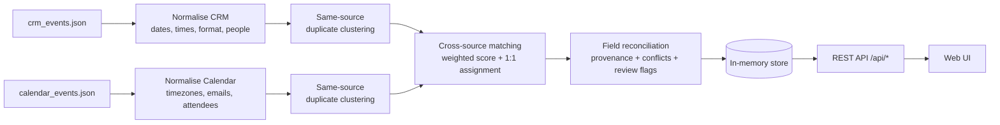

# Event Sync Service

Ingests meetings from a **CRM** and a **Calendar** feed, works out which records describe the same real-world meeting, and serves one reconciled list through a REST API and a small web UI. Every unified field shows which source it came from, which rule picked it, and whether the sources disagree.

## Quick start

Requirements: Python 3.10+ (tested on 3.13, Windows). No Node, no database.

```bash
python run.py
```

Then open http://127.0.0.1:8000 (interactive API docs at http://127.0.0.1:8000/docs).

`run.py` uses only the standard library. On first run it creates `./.venv`, installs the pinned `requirements.txt` (FastAPI, Uvicorn, tzdata), and starts the server. Later runs skip the install unless `requirements.txt` changes.

Optional:

```bash
# One-off report in the terminal (+ full JSON dump) without starting the server
.venv/Scripts/python -m event_sync.cli --json reconciled.json     # Windows
.venv/bin/python     -m event_sync.cli --json reconciled.json     # macOS/Linux
```

| Env var | Default | Purpose |
|---|---|---|
| `HOST` / `PORT` | `127.0.0.1` / `8000` | Bind address |
| `EVENT_SYNC_DATA_DIR` | `./data` | Folder with `crm_events.json` / `calendar_events.json` |
| `EVENT_SYNC_LOCAL_TZ` | `America/New_York` | Zone used for naive timestamps |
| `EVENT_SYNC_INTERNAL_DOMAINS` | `firma.com` | Comma-separated "our firm" email domains |
| `EVENT_SYNC_MATCH_THRESHOLD` | `0.55` | Minimum score to link CRM ↔ Calendar |
| `EVENT_SYNC_DUPLICATE_THRESHOLD` | `0.70` | Minimum score to merge same-source duplicates |
| `EVENT_SYNC_LOG_LEVEL` | `INFO` | `DEBUG` logs every parsing issue and every candidate match/duplicate score |

## Running the tests

```bash
.venv/Scripts/python -m pip install -r requirements-dev.txt    # Windows (macOS/Linux: .venv/bin/python)
.venv/Scripts/python -m pytest
```

There are 121 tests in `tests/`:

| File | Covers |
|---|---|
| `test_normalize.py` | Timestamp parsing (naive → ET, UTC with DST, lenient formats, garbage), CRM date/time formats, email repair, name/company/domain matching, location relations, abbreviations |
| `test_ingest.py` | Record mapping, missing ids, placeholder clients, garbage fields, missing/invalid/non-array files, one unmappable row being skipped and logged |
| `test_matching.py` | Duplicate vs recurring series, same-day gate, near-miss pairs staying below threshold, score bounds, one-to-one assignment |
| `test_pipeline.py` | The full run reproduces the hand-built mapping of all 42 records. Every conflict and data issue in the table below. Stable IDs. One failing group not breaking the sync |
| `test_api.py` | Every endpoint and filter, 404/422, re-sync, a failed re-sync still serving the last good result, 503 before any sync succeeds, a generic 500 that doesn't leak internals |

## Logging and error handling

- **Logging:** logs go to stderr as `time level module: message`.
  - `INFO` covers the sync lifecycle (records loaded, duplicates found, match counts, a summary with duration) and every API request with status and latency.
  - `DEBUG` adds each data-quality issue, every duplicate and match candidate score with its components, and each conflict. It's the quickest way to see why two records did or didn't link.
- **A bad record** is logged with its traceback and skipped. The rest of the file still loads.
- **A bad meeting group:** if reconciling a matched group fails, the service falls back to separate CRM and calendar meetings so no record disappears. Anything that still fails is listed in `stats.failed_records`.
- **Unreadable sources** (missing file, invalid JSON, wrong shape) raise `IngestError`:
  - `POST /api/sync` returns **502**, and the service keeps serving the previous good result. `/api/health` then reports `degraded` with the error.
  - If the very first sync fails, the server still starts and returns **503** with the reason until a sync succeeds.
- **Unexpected errors** are logged with a full traceback. The client only gets `500 Internal server error`.
- **`run.py`** gives a readable message instead of a traceback when the Python version is too old, the venv can't be created, pip install fails, or the port is already in use.

> Security note: the API has **no authentication**. It binds to localhost by default. Put it behind an authenticating proxy before exposing it.

---

## Flow



1. **Ingest**: each source is mapped into a common `SourceRecord`. Bad fields never crash ingestion. They become data-quality issues (`info` / `warning` / `error`) attached to the record, and the original payload is kept for display.
2. **Dedupe within a source**: same-day records with close start times, overlapping attendees, the same external organisation and similar titles are clustered. The most recently created record is treated as the current version.
3. **Match across sources**: every CRM cluster is scored against every calendar cluster on the same local date. Pairs above the threshold are assigned one-to-one, highest score first.
4. **Reconcile**: each matched group (or singleton) becomes one meeting. Every field gets a resolved value, provenance, the rule used, all candidate values, and a status (`agreed`, `single_source`, `complementary`, `variant`, `conflict`, `missing`).
5. **Serve**: the result lives in memory. `POST /api/sync` re-reads the files and swaps in the new result atomically.

---

## What I found in the data

The brief lists the problem types without saying where they are. Here is each case and how it is handled.

| Finding | Records | Handling |
|---|---|---|
| No shared ID between sources | all | Probabilistic matching on date, time, people, title, location and owner |
| Same-source duplicate | `CAL-A5` / `CAL-A6` (Pinnacle, 11:00 vs 11:30, same client domain; A6 created later and adds the CIO, whom CRM said "may" attend) | Merged into one meeting. A6 kept as current, A5 shown as merged. Time difference flagged |
| Recurring series that *looks* like a duplicate | `CAL-A3` / `CAL-A18` (Weekly Team Sync, a week apart) | **Not** merged. Same local date is a hard requirement for duplicates |
| Mixed timezone formats | `CAL-A4` uses `...Z` while everything else is naive | Naive = US Eastern. `19:00Z` → **15:00 EDT** (DST started 9 Mar 2025). CRM says 14:00, so this is flagged as a 1h start conflict rather than hidden. Naively assuming UTC-5 would have made it "match" by accident |
| Location conflict | `CRM-1002` In-Person / NYC office vs `CAL-A2` Zoom | High-severity `format` + `location` conflicts. Calendar value displayed, flagged for review |
| Status conflict | `CRM-1009` **Cancelled** (notes: "rescheduled to 3/26") vs `CAL-A10` confirmed | High-severity conflict. A cancellation in either source wins |
| Time conflict | `CRM-1016` 13:00 vs `CAL-A17` 15:00 | Still matched (client, title, Teams location agree). 2h high-severity conflict |
| Malformed date | `CRM-1008` `"03-15/2025"` | Lenient parse to 2025-03-15 with a warning. Matches `CAL-A9` |
| Missing time | `CRM-1007` `meeting_time: null` | Date-only record. Time neutral in matching, filled from calendar (`complementary`) |
| Malformed email | `CAL-A16` `raj.patel[at]atlasvc.com` | Repaired to `raj.patel@atlasvc.com` with a warning |
| Non-email attendee | `CAL-A20` `"external-guests"` | Kept as an *unresolved* attendee, warning |
| Non-standard timestamp | `CAL-A11` end `2025-03-14T20:00` (no seconds) | Parsed leniently, warning |
| Empty / null fields | `CAL-A11` (no attendees/location/description), several null CRM locations | Recorded as info. Fields shown as "not provided" |
| Placeholder client | `CRM-1017` client `"Multiple"` | Not treated as a person. Client list taken from calendar attendees |
| Compatible wording | "HQ - Conference Room B" vs "Conference Room B", "Teams" vs "Virtual - Microsoft Teams" | Not a conflict. Most specific value kept (`complementary`) |
| Different wording, probably same place | "The Palm - DC" vs "The Palm Restaurant" | Low-severity "variant" note |
| Owner ≠ organizer | `CRM-1013` owner Sarah Chen, `CAL-A14` organized by Priya Sharma | Low-severity note (they mean different things) |
| Single-source meetings | CRM only: 1003, 1010, 1020. Calendar only: A3, A11, A18, A19 | Shown with a source badge. Near-miss candidates listed (e.g. CRM-1003 vs CAL-A7 on the same afternoon) |

**Result:** 20 CRM + 22 calendar records → **24 unified meetings**: 17 in both sources, 3 CRM-only, 4 calendar-only, 1 duplicate merged. 5 meetings have medium/high conflicts and are flagged for review.

---

## Approach and key decisions

### 1. Matching: explainable scoring instead of a trained ML model

Each candidate pair (same local date only) gets a score in [0, 1]:

| Signal | Weight | How it's computed |
|---|---|---|
| time | 0.30 | `1 - minutes_apart / 240`. Neutral 0.5 if a side has no time |
| people | 0.25 | 1.0 if the CRM client is an attendee (name ↔ email local part). 0.8 if the company matches an attendee domain (`Meridian Capital` ~ `meridiancap.com`). 0.6 if both are internal |
| title | 0.25 | Token overlap of CRM subject + company vs calendar title. Uses crude stemming and a small abbreviation map (`DD`, `LPAC`, `QBR`) |
| location | 0.10 | Same / contained / similar wording. Falls back to virtual vs in-person |
| owner | 0.10 | CRM relationship owner is the organizer or an attendee |

Threshold is 0.55. Matches under 0.70 are marked low-confidence. Real matches here score 0.75–1.00. The closest non-match (`CRM-1017` vs `CAL-A19`, same evening) scores 0.37, which leaves a wide gap on both sides of the threshold. The UI shows the component breakdown and the reasons for every match.

**Why not ML?** I considered two options:

- **A supervised matcher** (logistic regression or gradient boosting on pair features). There are no labelled pairs, and 42 records is far too few to train or validate one honestly.
- **Sentence embeddings** for title similarity (e.g. `all-MiniLM-L6-v2`). This would help with abbreviations and synonyms, but it adds a ~100 MB model download and a heavy dependency, and makes scores harder to explain. With a hard same-day gate, the hard cases here are solved by structured signals (people, time) more than by semantics.

The scorer is a hand-weighted linear model in the style of Fellegi–Sunter record linkage. Given labelled data, the weights in `config.py` could be learned (logistic regression on the same features), and an embedding similarity could be added as one more signal without changing the pipeline.

### 2. Assignment is one-to-one, greedy by score
A CRM record maps to at most one calendar meeting and vice versa. Because of the same-day gate the candidate graph is tiny, so greedy gives the same result as Hungarian assignment here and is easier to explain.

### 3. Duplicates are resolved before matching
Merging `CAL-A5`/`CAL-A6` first means the CRM record links to one meeting instead of "winning" one invite and leaving a phantom calendar-only meeting.

### 4. Field-level source-of-truth rules
Conflicts are never resolved silently. A value is picked so the list stays usable, and the disagreement is shown with a severity.

| Field | Preferred source | Reasoning |
|---|---|---|
| start / end | Calendar (latest invite) | The calendar is what attendees actually receive. CRM has no duration |
| format / location | Calendar (or the most specific compatible wording) | Same reason. Compatible values are combined, not flagged |
| status | Cancellation in any source wins, else CRM wording | A stale invite left behind after cancelling is common. CRM status is more specific ("completed") |
| client / company / owner | CRM | The CRM is the relationship system of record. Calendar attendees are the fallback |
| attendees | Union | Each person lists which records mention them |
| notes / description | Both, as-is | Free text isn't reconciled |

Conflict severity: **high** = different time ≥ 60 min, virtual vs in-person, cancelled vs active. **medium** = smaller time gap, different places of the same kind, tentative vs confirmed. **low** = wording variants, owner vs organizer, client not on invite.

### 5. Timezone assumption
Naive timestamps are treated as `America/New_York`, because the offices referenced are DC, NYC and Boston. This is configurable. It's the most consequential assumption in the project, because it decides whether `CAL-A4` conflicts with CRM.

### 6. Simple, single-command stack
FastAPI + vanilla HTML/JS, no build step, no database. The data is static files and small, so in-memory state with an atomic re-sync is enough. A real sync service would persist results and poll or receive webhooks from the upstream APIs.

---

## API

| Method | Path | Description |
|---|---|---|
| GET | `/api/health` | Liveness + last sync time |
| GET | `/api/stats` | Counts, conflict breakdown, data-quality counts, active settings |
| GET | `/api/meetings` | Summaries. Filters: `source=both\|crm\|calendar`, `conflicts=true`, `needs_review=true`, `q=text` |
| GET | `/api/meetings/{id}` | Full meeting: fields with provenance and candidates, conflicts, match explanation, merged duplicates, near misses, data-quality issues, raw records |
| GET | `/api/sources/{crm\|calendar}` | Raw source records, their issues and the meeting each was placed in |
| POST | `/api/sync` | Re-read both files and rebuild |

Meeting IDs are a hash of the member record IDs, so they stay stable across re-syncs of the same data.

## Using the UI

- The top cards summarise the sync. Filters narrow the list by source, conflicts, review status or free text.
- Each row shows source badges (purple **CRM**, blue **CAL**) with record IDs, and a conflict badge coloured by severity.
- Selecting a meeting opens:
  - the **Field provenance** table: unified value, which record it came from, the rule used, and the raw CRM and Calendar values side by side (conflicts highlighted red, wording differences orange)
  - the conflict list
  - everyone involved, with the records that mention them
  - why the records were matched (score bars + reasons), or near misses for single-source meetings
  - merged duplicates, data-quality issues, and the raw JSON of each source record

## Project structure

```
run.py                 single-command launcher (venv bootstrap + server)
requirements.txt       pinned dependencies
data/                  upstream payloads (unchanged)
event_sync/
  config.py            all tunables (weights, thresholds, timezone, internal domains)
  models.py            SourceRecord / DataIssue
  normalize.py         parsing: timestamps, dates, emails, locations, tokens
  ingest.py            source → SourceRecord mappers (defensive, issue-collecting)
  matching.py          duplicate clustering, cross-source scoring, 1:1 assignment
  reconcile.py         field rules, provenance, conflicts, review flags
  service.py           pipeline orchestration + thread-safe in-memory store (keeps last good result)
  api.py               FastAPI routes, request logging, error handlers, static frontend mount
  cli.py               terminal report / JSON export (--log-level DEBUG)
  logging_config.py    shared logging setup
tests/                 pytest suite (121 tests)
requirements-dev.txt   pytest + httpx for the test suite
frontend/              index.html, app.js, styles.css (no build step)
docs/AI_COLLABORATION.md  how AI was used: analysis, planning, decisions
```

## Limitations and next steps

- Tests cover the backend only. The UI has no automated browser tests.
- `CRM-1009` says "rescheduled to 3/26". I only surface that as a note. Parsing free-text reschedules wasn't attempted.
- Weights are hand-tuned on this dataset. With more data, learn them from labelled pairs and check precision/recall.
- No persistence, no reviewer workflow (accept or override a resolution), no auth.
- The timezone assumption is global. Per-office or per-user zones would be more correct.

## Time spent

- data analysis, pipeline, API, UI, README.
